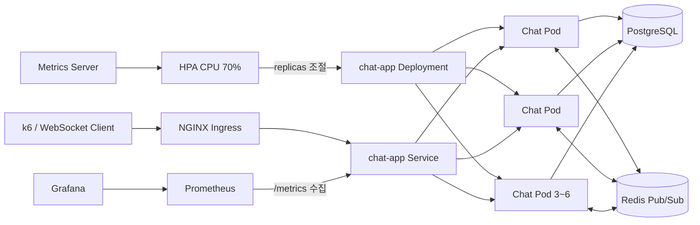
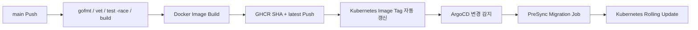

# Go WebSocket Chat Platform

Go로 구현한 실시간 WebSocket 채팅 서버를 Docker와 Kubernetes에 배포하고, Redis Pub/Sub 다중 Pod Broadcast, PostgreSQL 영속 저장, GitOps CI/CD, Prometheus·Grafana 모니터링, HPA 자동 확장과 k6 부하 테스트까지 검증한 DevOps 포트폴리오 프로젝트입니다.

## 핵심 성과

- Go Goroutine과 Channel 기반 WebSocket Connection 관리
- PostgreSQL Message 영속 저장과 버전 기반 Migration
- Redis Pub/Sub을 이용한 여러 Chat Pod 간 실시간 Broadcast
- GitHub Actions 기반 Test, Build, GHCR Image Push와 Manifest 자동 갱신
- ArgoCD 기반 Kubernetes 자동 동기화, Prune과 Self Heal
- Prometheus Application Metric 수집과 Grafana 시각화
- CPU 기반 HPA로 Chat Pod `3 → 6 → 4 → 3` 자동 확장·축소 검증
- k6 사용자 300명, Message 전달 성공률 100%, Packet Drop 0 달성

## 아키텍처




Message 처리 흐름:

```text
WebSocket Client
→ NGINX Ingress
→ Kubernetes Service
→ Chat Pod
→ PostgreSQL 저장
→ Redis Channel Publish
→ 모든 Chat Pod Subscribe
→ 각 Pod의 WebSocket Client에게 Broadcast
```

기존 WebSocket Connection은 새 Pod가 생성돼도 이동하지 않습니다. HPA 확장 후 들어오는 신규 Connection부터 새 Pod로 분산됩니다.

## 기술 스택

| 영역 | 기술 |
|---|---|
| Backend | Go 1.25, net/http, Gorilla WebSocket |
| Database | PostgreSQL 17, pgx, golang-migrate |
| Messaging | Redis 8 Pub/Sub, go-redis |
| Container | Docker, Docker Compose |
| Orchestration | Kubernetes, Minikube, Helm, NGINX Ingress, HPA |
| CI/CD | GitHub Actions, GHCR, ArgoCD |
| Observability | Prometheus, Grafana, Metrics Server, ServiceMonitor |
| Load Test | k6 WebSocket |
| Network | Tailscale, NodePort, socat |

## 300명 HPA 부하 테스트

테스트 조건:

```text
가상 사용자: 300명
Ramp: 300초
Hold: 300초
Message 주기: 사용자당 1초
총 실행 시간: 약 10분
```

결과:

| 항목 | 결과 |
|---|---:|
| WebSocket Connection | 300/300, 100% |
| Message 전달 | 300/300, 100% |
| Check | 225,290/225,290 |
| 정상 완료 | 300 |
| 중단 | 0 |
| 연결 p95 | 104.44ms |
| Message 지연 평균 | 207.49ms |
| Message 지연 p95 | 823.79ms |
| Message 최대 지연 | 6.4초 |
| 송신 Message | 112,945 |
| 수신 Message | 29,361,590 |
| 수신 데이터 | 4.0GB |
| Packet Drop | 0 |
| PostgreSQL 최대 IOPS | 약 750 io/s |
| PostgreSQL 최대 처리량 | 약 3.4MB/s |

HPA 변화:

```text
CPU 1% → 최대 247%
Chat Pod 3개 → 6개
부하 종료 및 5분 안정화
Chat Pod 6개 → 4개 → 3개
```

결과 화면은 [`goChat 1/스샷/HPA`](<goChat 1/스샷/HPA>)에 보관되어 있습니다.

## 애플리케이션 설계

### WebSocket 안정성

- Client별 Buffered Send Queue
- Queue가 가득 찬 느린 Client 자동 연결 해제
- Ping/Pong과 Read Deadline으로 죽은 Connection 정리
- 4KiB Frame 제한
- 이름 50자, Message 2,000자 제한
- 입장 전 Chat 차단
- Client가 보낸 `sender`를 신뢰하지 않고 서버에 등록된 이름 사용
- Origin Allowlist 지원

### 데이터와 메시징

- Chat Message를 PostgreSQL에 먼저 저장
- DB가 발급한 `id`와 `createdAt`을 포함해 Redis에 Publish
- 모든 Chat Pod가 같은 Redis Channel을 Subscribe
- Pod마다 자신의 WebSocket Client에게 Broadcast
- DB Connection Pool과 Schema 준비 상태 확인

### 운영 안정성

- Liveness와 Readiness Probe
- PostgreSQL·Redis·Schema를 포함한 Readiness 검사
- SIGINT/SIGTERM Graceful Shutdown
- JSON 구조화 Log
- CPU·Memory Request와 Limit
- Rolling Update
- HPA Scale Up과 5분 Scale Down 안정화

## Endpoint

| Endpoint | 역할 |
|---|---|
| `GET /health/live` | Process 생존 확인 |
| `GET /health/ready` | PostgreSQL, Schema, Redis 준비 상태 확인 |
| `GET /stats` | 현재 Pod의 WebSocket Connection 수 |
| `GET /metrics` | Prometheus Metric |
| `GET /ws` | WebSocket Upgrade |

Application Metric:

```text
chat_websocket_connections
```

전체 Pod의 Connection 합계:

```promql
sum(chat_websocket_connections)
```

## WebSocket Protocol

입장:

```json
{"type":"join","sender":"alice","content":""}
```

채팅:

```json
{"type":"chat","sender":"","content":"안녕하세요"}
```

서버 Broadcast:

```json
{
  "id": 1,
  "type": "chat",
  "sender": "alice",
  "content": "안녕하세요",
  "createdAt": "2026-07-13T00:00:00Z"
}
```

## CI/CD와 GitOps



GitHub Actions:

1. Go Module Download
2. `gofmt` 검사
3. `go vet`
4. `go test -race -cover ./...`
5. Server와 Migration Binary Build
6. Docker Image Build
7. GHCR에 Commit SHA와 `latest` Tag Push
8. Helm Chart `values.yaml`의 Image Tag 자동 Commit

ArgoCD:

- `helm/chat` 경로의 Helm Chart와 `chat` Namespace 연결
- Automated Sync
- Prune
- Self Heal
- PreSync Migration
- 실패 시 Retry

## 프로젝트 구조

```text
chat/
├── .github/workflows/
│   └── ci.yml                     # Test, Image Push, Manifest 갱신
├── app/
│   ├── cmd/
│   │   ├── server/main.go         # Chat Server 진입점
│   │   └── migrate/main.go        # Migration CLI 진입점
│   ├── internal/
│   │   ├── application/           # 구성요소 조립과 실행 생명주기
│   │   ├── chat/                  # Client, Hub, Handler, Message
│   │   ├── config/                # 환경변수 설정
│   │   ├── database/              # PostgreSQL와 Repository
│   │   ├── messaging/             # Redis Pub/Sub
│   │   └── server/                # HTTP Server, Router, Metric
│   ├── migrations/                # Version 기반 SQL Migration
│   ├── go.mod
│   └── go.sum
├── argocd/
│   └── chat-application.yaml      # ArgoCD Application
├── docker/
│   ├── Dockerfile                 # Multi-stage Go Image
│   └── compose.yml                # Local App, PostgreSQL, Redis
├── helm/
│   └── chat/
│       ├── Chart.yaml
│       ├── values.yaml
│       └── templates/
│           ├── chat-deployment.yaml
│           ├── chat-service.yaml
│           ├── chat-ingress.yaml
│           ├── chat-hpa.yaml
│           ├── chat-servicemonitor.yaml
│           ├── migration-job.yaml
│           ├── postgres-*.yaml
│           └── redis-*.yaml
├── loadtest/
│   ├── websocket-smoke.js
│   ├── websocket-load.js
│   └── websocket-hpa.js
├── goChat 1/                      # 개념, 실습, 장애 해결 기록
└── README.md
```

## 로컬 실행

필요 항목:

- Go 1.25 이상
- Docker와 Docker Compose

환경설정:

```bash
cp app/.env.example app/.env
openssl rand -hex 32
```

생성한 값을 `app/.env`의 `DB_PASSWORD`에 입력합니다. 실제 `.env`와 Secret 값은 Git에 Commit하지 않습니다.

실행:

```bash
docker compose \
  --env-file app/.env \
  -f docker/compose.yml \
  up -d --build
```

확인:

```bash
docker compose --env-file app/.env -f docker/compose.yml ps
curl http://localhost:8080/health/live
curl http://localhost:8080/health/ready
```

종료:

```bash
docker compose --env-file app/.env -f docker/compose.yml down
```

`down -v`는 PostgreSQL Volume도 제거하므로 저장 데이터를 보존하려면 사용하지 않습니다.

## Test

```bash
cd app
go test ./...
go test -race -cover ./...
go vet ./...
```

k6 10명 검증:

```bash
k6 run \
  -e WS_URL=ws://100.126.215.15:8080/ws \
  -e VUS=10 \
  -e RAMP_SECONDS=10 \
  -e HOLD_SECONDS=30 \
  -e MESSAGE_INTERVAL_MS=1000 \
  loadtest/websocket-hpa.js
```

300명 HPA Test:

```bash
k6 run \
  -e WS_URL=ws://100.126.215.15:8080/ws \
  -e VUS=300 \
  -e RAMP_SECONDS=300 \
  -e HOLD_SECONDS=300 \
  -e MESSAGE_INTERVAL_MS=1000 \
  loadtest/websocket-hpa.js
```

## 검증 범위와 한계

이번 결과는 단일 Mini PC의 Minikube 단일 Node 환경에서 측정했습니다.

- Pod 자동 확장과 Application 수준의 분산은 검증했습니다.
- 물리 Node 장애와 Multi-Node 고가용성은 검증하지 않았습니다.
- Redis와 PostgreSQL은 각각 단일 Replica입니다.
- `socat`은 Tailscale과 Minikube NodePort를 연결하기 위한 실습용 중계입니다.
- 운영 환경에서는 LoadBalancer, DNS, TLS, Secret Manager, PostgreSQL·Redis HA가 추가로 필요합니다.
