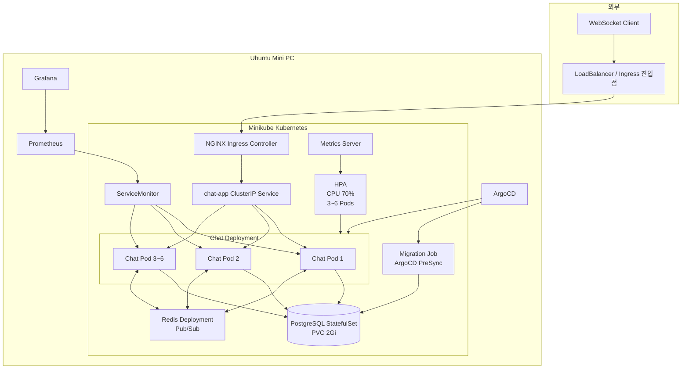
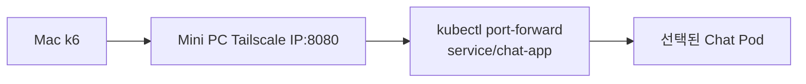
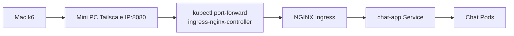
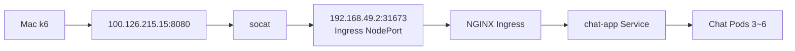
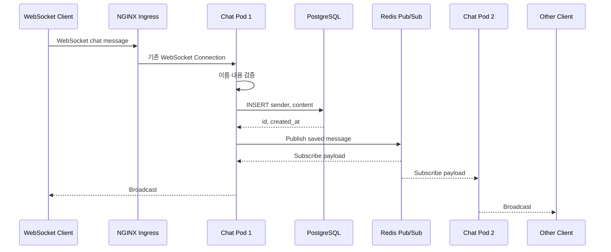
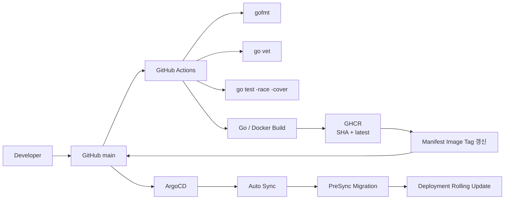
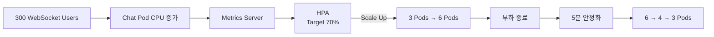

# 전체 시스템 구조도

![[프로젝트 전체 DevOps 구조도.png]]

위 그림은 개발, CI, Registry, GitOps CD, Kubernetes 운영, 모니터링과 부하 테스트를 하나의 흐름으로 표현한 포트폴리오용 전체 구조도다.

## Runtime Architecture



메인 Runtime 구조는 외부 진입점에서 NGINX Ingress로 들어온 요청이 `chat-app` Service와 Chat Pod로 전달되는 형태다.

`kubectl port-forward`와 `socat`은 Application Runtime 구성요소가 아니라 이 구조에 외부 Mac을 연결하기 위해 실습 중 사용한 임시 접속 수단이다.

---

## 부하 테스트 접속 경로

### 단일 Chat Pod 확인



Ingress를 건너뛰고 선택된 Chat Pod에 직접 연결한다. 초기 10명과 50명 테스트에서 Application 기능과 단일 Pod 부하를 확인하는 데 사용하였다.

### Ingress 통합 확인



Ingress의 WebSocket Upgrade와 여러 Chat Pod로 신규 Connection이 분산되는지 확인하는 데 사용하였다.

### 300명 HPA 최종 시험



`kubectl port-forward`가 대량 Traffic 중 `broken pipe`로 끊긴 뒤 사용한 최종 테스트 경로다.

운영 환경에서는 `socat` 대신 정식 LoadBalancer, DNS와 TLS가 외부 진입점을 담당한다.

---

## Chat Message Flow



Message 저장에 실패하면 Redis Publish를 실행하지 않는다. 저장된 Message만 ID와 생성 시간을 포함해 모든 Pod로 전달한다.

---

## WebSocket Connection Lifecycle

```text
HTTP /ws 요청
→ WebSocket Upgrade
→ Client 생성
→ Hub Register
→ join Message 검증
→ 이름 등록
→ Redis를 통한 입장 Broadcast
→ chat Message 수신
→ PostgreSQL 저장
→ Redis Publish
→ Local Hub Broadcast
→ Ping/Pong으로 연결 확인
→ 종료 시 Hub Unregister
→ Redis를 통한 퇴장 Broadcast
```

Client마다 Read Pump와 Write Pump가 동작한다. Send Queue가 가득 찬 느린 Client는 다른 사용자에게 영향을 주지 않도록 연결을 제거한다.

---

## CI/CD Architecture



GitHub Actions는 CI와 Image 생산을 담당한다. ArgoCD는 Git의 Manifest를 기준으로 Kubernetes 배포를 담당한다.

---

## Observability Architecture

```text
Chat Pod /metrics
        ↓ ServiceMonitor
Prometheus
        ↓ PromQL
Grafana

kubelet / cAdvisor / kube-state-metrics
        ↓
Prometheus
        ↓
CPU, Memory, Network, Packet Drop, Storage I/O

Metrics Server
        ↓ Metrics API
kubectl top + HPA
```

Prometheus와 Metrics Server의 목적은 다르다.

- Metrics Server: 현재 CPU·Memory와 HPA 판단
- Prometheus: Metric 수집·저장과 시간 흐름 분석
- Grafana: Prometheus 데이터 시각화

---

## HPA Flow



기존 WebSocket Connection은 HPA 확장으로 새 Pod가 생성돼도 이동하지 않는다. 새 Connection부터 새 Pod로 분산된다.

---

## Kubernetes Resource Relationship

```text
Namespace: chat
├── ConfigMap: chat-app-config
├── Secret: postgres-secret
├── Deployment: chat-app
│   ├── Service: chat-app
│   ├── Ingress: chat-app
│   ├── ServiceMonitor: chat-app
│   └── HPA: chat-app
├── Deployment: redis
│   └── Service: redis
├── StatefulSet: postgres
│   ├── Service: postgres
│   └── PVC: postgres-data
└── Job: chat-migrate
    └── ArgoCD PreSync Hook
```

---

## 장애 경계

현재는 Minikube 단일 Node 환경이다.

```text
Chat Pod 장애
→ Deployment가 새 Pod 생성 가능

부하 증가
→ HPA가 Chat Pod 확장 가능

Mini PC 또는 Minikube Node 전체 장애
→ 단일 Node이므로 서비스 전체 영향

PostgreSQL 또는 Redis 장애
→ 단일 Replica이므로 서비스 준비 상태 실패
```

현재 구조는 Application과 Pod 수준의 복구·확장을 검증한 구성이다. Multi-Node, Database HA와 Redis HA는 후속 운영 과제다.
